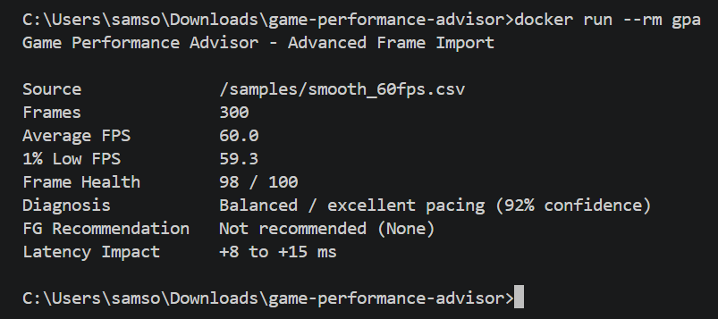
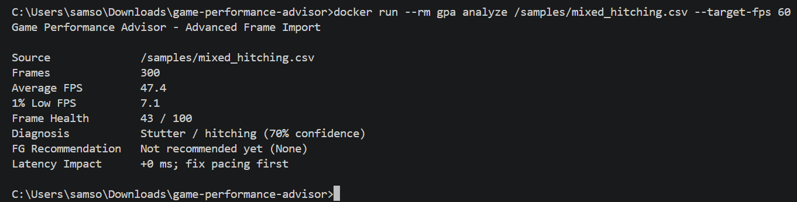
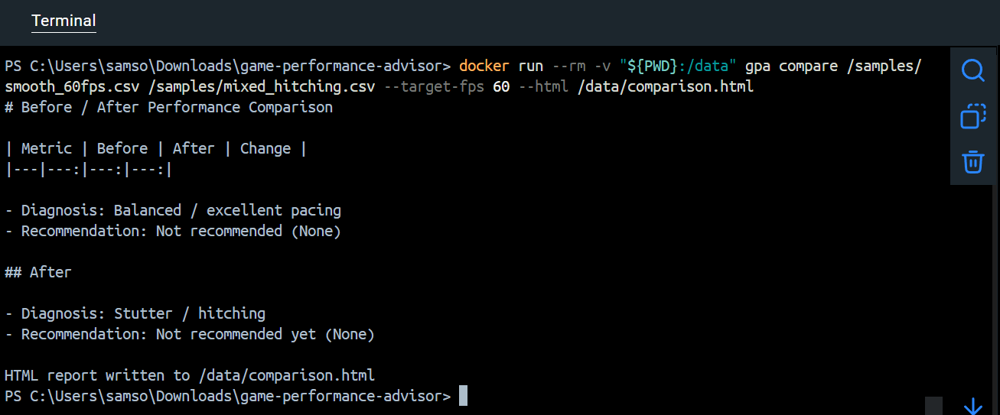
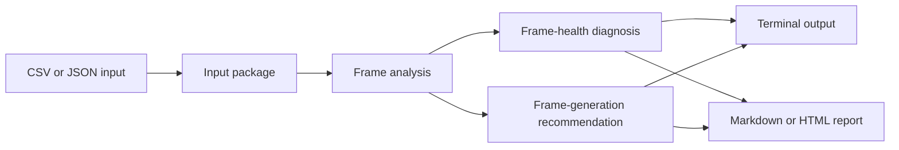
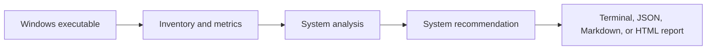

# Game Performance Advisor

Game Performance Advisor is a cross-platform Go CLI for analyzing game frame-time data. The primary workflow runs on Linux, macOS, and Windows, with Docker support so a reviewer can build and run it without installing Go.

GPA reads frametime CSV files and calculates average FPS, 1% and 0.1% lows, frame pacing, stutter percentage, frame health, and likely bottlenecks. It can also compare before-and-after recordings and suggest whether frame generation is suitable.

## Quick Start: Docker

Docker is the quickest way to run and review the project.

Build the image:

```bash
docker build -t gpa .
```

Run the bundled sample:

```bash
docker run --rm gpa
```

The default command analyzes `samples/smooth_60fps.csv` and prints the FPS statistics immediately.



Analyze another bundled sample:

```bash
docker run --rm gpa analyze /samples/mixed_hitching.csv --target-fps 60
docker run --rm gpa analyze /samples/cpu_stutter.csv --target-fps 60
```



Mount a CSV from the host and analyze it:

```bash
docker run --rm -v "${PWD}:/data" gpa analyze /data/recording.csv --target-fps 144
```

The container uses a Linux binary. Frame-time analysis works in Docker on Linux, macOS, and Windows hosts.

Compare two bundled samples and write an HTML report into the current host directory:

```cmd
docker run --rm -v "%CD%:/data" gpa compare /samples/smooth_60fps.csv /samples/mixed_hitching.csv --target-fps 60 --html /data/comparison.html
```



The generated HTML report is available at [comparison.html](comparison.html).

## Frame-Time CSV Format

GPA accepts CSV files with this two-column format:

```csv
frame,frametime_ms
1,16.67
2,16.71
3,16.69
```

The `frametime_ms` column is required. The `frame` column is accepted but does not participate in the calculations.

Bundled samples are in [`samples/`](samples/). Tools that export frametime data, such as CapFrameX or RTSS, can produce compatible files after column export or conversion. GPA does not parse raw multi-column capture formats directly.

## CLI Commands

### Analyze one recording

```bash
gpa analyze recording.csv --target-fps 60
gpa analyze recording.csv --target-fps 144 --json
gpa analyze recording.csv --target-fps 60 --report frame-analysis.md
```

The `analyze` command supports:

- `--target-fps <fps>`: target average FPS, default `60`
- `--stutter-threshold <ratio>`: stutter ratio, default `1.8`
- `--input-format auto|csv|json`: input format, default `auto`
- `--json`: print machine-readable JSON
- `--report <file.md>`: write a Markdown report

### Compare before and after recordings

```bash
gpa compare before.csv after.csv --target-fps 60
gpa compare before.csv after.csv --target-fps 60 --report comparison.md --html comparison.html
```

The `compare` command supports:

- `--target-fps <fps>`: target average FPS
- `--before-label <text>`: label for the before recording
- `--after-label <text>`: label for the after recording
- `--report <file.md>`: write a Markdown comparison
- `--html <file.html>`: write an HTML comparison

Running `gpa --help` prints the command summary.

## How It Works

The application is split into small Go packages:

```text
cmd/game-performance-advisor/
  CLI entry point and command dispatch

internal/input/
  CSV and JSON frame-time parsing

internal/analysis/
  FPS, percentile low-FPS, stutter, and frame-health calculations

internal/recommend/
  Upscaling and frame-generation recommendations

internal/report/
  Terminal, JSON, Markdown, and HTML report rendering

internal/system/
  Windows and Linux system inventory

internal/metrics/
  Windows and Linux live metric collection
```

The `analyze` and `compare` commands read the supplied files and do not require live machine access. This is the cross-platform core of the project.

## Scope and Verification

The primary submission scope is frame-time CSV analysis and Docker execution. System inventory, monitoring, report formats, and Windows-only hardware support are existing supporting features, not the main reviewer demonstration.

The frame-time calculations are verified with known values rather than only by ensuring the tests compile:

- `100 × 16.67 ms` with no hitching has 60 FPS average, zero stutters, and 100/100 frame health under the smooth test thresholds.
- `16 ms` repeated nine times with `50 ms` for the tenth frame has one stutter and a median of `16 ms`.
- A 1000-frame dataset with nine slow `16.67 ms` frames and one `100 ms` frame has approximately 39.995 FPS 1% low and 10 FPS 0.1% low.
- A 100-frame dataset alternating `16.67 ms` and `33.34 ms` has a 25.005 ms average and approximately 33.333% coefficient of variation.
- The 1%/0.1% low calculations sort frametimes, take the slowest `ceil(frame_count × 0.01)` or `ceil(frame_count × 0.001)` frames, average those frametimes, and convert `1000 / average_ms` to FPS.
- A stutter is counted when a frametime is greater than `1.8 ×` the median; the default threshold is configurable with `--stutter-threshold`.

For the 1000-frame 1% low example, 999 frames are `16.67 ms` and one frame is `100 ms`. GPA sorts the frametimes and takes the slowest `ceil(1000 × 0.01) = 10` frames. It averages their frametimes: `(9 × 16.67 + 100) ÷ 10 = 25.003 ms`. It then converts that average to FPS: `1000 ÷ 25.003 = approximately 39.995 FPS`. For 0.1% low, it takes the slowest `ceil(1000 × 0.001) = 1` frame and converts `100 ms` to `10 FPS`.

These rules are implemented in [the analysis package](internal/analysis/analysis.go). The unit tests cover smooth data, 1%/0.1% low values, coefficient-of-variation frame pacing, one hitch, invalid input, and occasional hitch classification.

## Live Demo

Run the Docker workflow as the primary interview demonstration:

```bash
docker build -t gpa .
docker run --rm gpa
docker run --rm gpa analyze /samples/mixed_hitching.csv --target-fps 60
docker run --rm gpa compare /samples/smooth_60fps.csv /samples/mixed_hitching.csv --target-fps 60
```

The final command shows a 60 FPS smooth recording compared with a 47.4 FPS recording containing 4.0% stutters. This live sequence demonstrates parsing, analysis, diagnosis, and before/after reporting without requiring Windows hardware access.

## Design

The frame-time workflow is independent of the operating system and can run in Docker:



The Windows-only workflow follows a separate hardware path:



The CLI dispatches to these paths in [the application entry point](cmd/game-performance-advisor/main.go). The frame-time packages require no Windows APIs, while the hardware packages use Windows collection when available and return a clear fallback outside Windows.

## AI-Assisted Development Workflow

This project was developed iteratively with GitHub Copilot:

### How I directed Copilot

- **Scope freeze:** I told Copilot to remove PresentMon support claims and make the CSV contract explicit: "Frame analysis accepts CSV files with `frame,frametime_ms` columns." I also required it to change documentation only, verify `go test ./...`, and verify `docker run --rm gpa`.
- **README clarity:** I asked for separate instructions for Windows users, developers, and Docker reviewers. I also required claims to be verified against `main.go`, `go.mod`, and the Dockerfile rather than invented.
- **Cross-platform refactor:** I requested that `scan` and `monitor` use `runtime.GOOS` and fail gracefully outside Windows, while `analyze` and `compare` continue to work. I did not allow a rewrite of the frame-analysis code.
- **Platform tests:** I asked for a test that can verify non-Windows fallback behavior without attempting Windows hardware collection.
- **Architecture and submission evidence:** I requested Mermaid diagrams from copilot to make diagrams for this README

### How I evaluated and corrected the output

1. **Checked source-of-truth files** - Copilot had to inspect `go.mod`, `main.go`, the system/metrics collectors, and the Dockerfile before making claims.
2. **Rejected unsupported edits** - I required README-only changes during scope-freeze work and did not allow parser, dependency, test, sample, or Dockerfile changes outside the requested task.
3. **Found and fixed verification failures** - A new fallback implementation initially failed Go vet due to a non-constant `fmt.Errorf` format. Copilot replaced it with `errors.New`, and both the Docker build and Go tests were rerun.
4. **Verified Docker behavior** - I required the default container command to print the 60-FPS sample analysis and separately checked `scan` and `monitor` inside the Linux image.
5. **Rejected technically passing but misleading claims** - One README draft said Linux hardware access was unavailable even though the code also has Linux `/proc` CPU, memory, process, and inventory collectors. The implementation could pass every test and still overstate the limitation, so I rewrote the wording to keep Windows diagnostics as the bonus feature and describe Docker as an intentionally limited Linux frame-analysis environment.
6. **Validated diffs** - I reviewed changed files and did not retain unrelated worktree changes or assume that a prebuilt `.exe` existed.
7. **Checked the analysis math independently** - I verified the formula for 1% and 0.1% low FPS, coefficient of variation, and the `median × 1.8` stutter threshold against known datasets, then added exact known-value assertions.

The prompts were deliberately specific about scope, affected files, required behavior, and validation commands. Copilot's first plausible implementation was not accepted automatically; repository evidence and test/container output were used to correct it.

Representative tools and checks used:

- Go tests for frame parsing, analysis, reporting, recommendations, and CLI behavior.
- Docker Desktop to build the Linux image and run the bundled sample.
- Git diff review to confirm that changes remained focused.
- The actual Go entry point and package code, rather than assumptions, to verify command flags and platform behavior.

Approximate time: around 2 days

## Development

Requires Go. Run all unit tests:

```bash
go test ./...
```

Build a native executable:

```bash
go build -trimpath -ldflags="-s -w" -o gpa ./cmd/game-performance-advisor
```

On Windows, build `gpa.exe`:

```powershell
go build -trimpath -ldflags="-s -w" -o gpa.exe .\cmd\game-performance-advisor
```

The Dockerfile uses a multi-stage build:

1. A Go Linux image runs `go test ./...`.
2. The same stage compiles a static Linux binary.
3. A scratch image contains the binary and bundled samples.
4. The default command runs `analyze` on the smooth 60-FPS sample.

## Bonus: Windows Hardware Diagnostics

On Windows, GPA can additionally provide live hardware diagnostics:

```powershell
.\gpa.exe scan
.\gpa.exe monitor --duration 15 --interval 2
```

The `scan` command inspects Windows hardware and live utilization. The `monitor` command collects repeated utilization snapshots. These commands use Windows-specific inventory and metric collection and are only supported on Windows.

On Linux or macOS, `scan` and `monitor` return a helpful message directing you to `analyze` and `compare`. Frame-time analysis remains available without Windows-specific hardware access.
