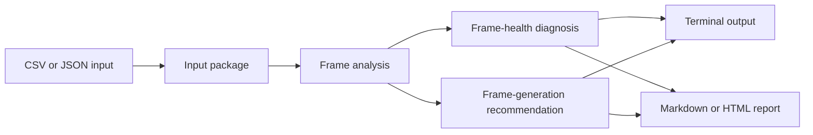
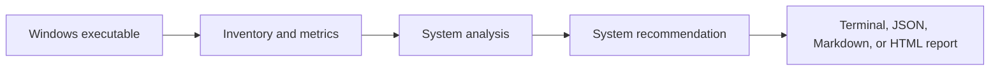

# Game Performance Advisor

Game Performance Advisor is a cross-platform Go CLI for analyzing game frame-time data. The primary workflow runs on Linux, macOS, and Windows, with Docker support so a reviewer can build and run it without installing Go.

GPA reads frametime CSV files and calculates average FPS, 1% and 0.1% lows, frame pacing, stutter percentage, frame health, and likely bottlenecks. It can also compare before-and-after recordings and suggest whether frame generation is suitable.

## Quick Start: Docker

Docker is the quickest way to run and review the project.

Build the image:

```bash
docker build -t gpa .
```

Run the bundled sample:

```bash
docker run --rm gpa
```

The default command analyzes `samples/smooth_60fps.csv` and prints the FPS statistics immediately.

Analyze another bundled sample:

```bash
docker run --rm gpa analyze /samples/mixed_hitching.csv --target-fps 60
docker run --rm gpa analyze /samples/cpu_stutter.csv --target-fps 60
```

Mount a CSV from the host and analyze it:

```bash
docker run --rm -v "${PWD}:/data" gpa analyze /data/recording.csv --target-fps 144
```

The container uses a Linux binary. Frame-time analysis works in Docker on Linux, macOS, and Windows hosts.

## Frame-Time CSV Format

GPA accepts CSV files with this two-column format:

```csv
frame,frametime_ms
1,16.67
2,16.71
3,16.69
```

The `frametime_ms` column is required. The `frame` column is accepted but does not participate in the calculations.

Bundled samples are in [`samples/`](samples/). Tools that export frametime data, such as CapFrameX or RTSS, can produce compatible files after column export or conversion. GPA does not parse raw multi-column capture formats directly.

## CLI Commands

### Analyze one recording

```bash
gpa analyze recording.csv --target-fps 60
gpa analyze recording.csv --target-fps 144 --json
gpa analyze recording.csv --target-fps 60 --report frame-analysis.md
```

The `analyze` command supports:

- `--target-fps <fps>`: target average FPS, default `60`
- `--stutter-threshold <ratio>`: stutter ratio, default `1.8`
- `--input-format auto|csv|json`: input format, default `auto`
- `--json`: print machine-readable JSON
- `--report <file.md>`: write a Markdown report

### Compare before and after recordings

```bash
gpa compare before.csv after.csv --target-fps 60
gpa compare before.csv after.csv --target-fps 60 --report comparison.md --html comparison.html
```

The `compare` command supports:

- `--target-fps <fps>`: target average FPS
- `--before-label <text>`: label for the before recording
- `--after-label <text>`: label for the after recording
- `--report <file.md>`: write a Markdown comparison
- `--html <file.html>`: write an HTML comparison

Running `gpa --help` prints the command summary.

## How It Works

The application is split into small Go packages:

```text
cmd/game-performance-advisor/
  CLI entry point and command dispatch

internal/input/
  CSV and JSON frame-time parsing

internal/analysis/
  FPS, percentile low-FPS, stutter, and frame-health calculations

internal/recommend/
  Upscaling and frame-generation recommendations

internal/report/
  Terminal, JSON, Markdown, and HTML report rendering

internal/system/
  Windows and Linux system inventory

internal/metrics/
  Windows and Linux live metric collection
```

The `analyze` and `compare` commands read the supplied files and do not require live machine access. This is the cross-platform core of the project.

## Design

The frame-time workflow is independent of the operating system and can run in Docker:



The Windows-only workflow follows a separate hardware path:



The CLI dispatches to these paths in [the application entry point](cmd/game-performance-advisor/main.go). The frame-time packages require no Windows APIs, while the hardware packages use Windows collection when available and return a clear fallback outside Windows.

## AI-Assisted Development Workflow

This project was developed iteratively with GitHub Copilot:

1. **Scoped the product** - kept frame-time CSV analysis as the primary cross-platform workflow and treated Windows hardware diagnostics as an optional bonus.
2. **Mapped the existing code** - inspected the CLI, input, analysis, recommendation, report, system, metrics, and Docker packages before changing behavior.
3. **Implemented in small increments** - added non-Windows CLI guards, platform-focused tests, Docker-first documentation, and clarified CSV compatibility.
4. **Verified behavior** - ran `go test ./...`, rebuilt the Docker image, ran the default sample, and checked the Docker fallback for `scan` and `monitor`.
5. **Documented the result** - added Docker-first setup, command examples, architecture diagrams, Windows limitations, and this AI-assisted workflow.

Representative tools and checks used:

- Go tests for frame parsing, analysis, reporting, recommendations, and CLI behavior.
- Docker Desktop to build the Linux image and run the bundled sample.
- Git diff review to confirm that changes remained focused.
- The actual Go entry point and package code, rather than assumptions, to verify command flags and platform behavior.

Approximate time: no dedicated stopwatch was used, so elapsed time is not reported as a precise claim.

## Development

Requires Go. Run all unit tests:

```bash
go test ./...
```

Build a native executable:

```bash
go build -trimpath -ldflags="-s -w" -o gpa ./cmd/game-performance-advisor
```

On Windows, build `gpa.exe`:

```powershell
go build -trimpath -ldflags="-s -w" -o gpa.exe .\cmd\game-performance-advisor
```

The Dockerfile uses a multi-stage build:

1. A Go Linux image runs `go test ./...`.
2. The same stage compiles a static Linux binary.
3. A scratch image contains the binary and bundled samples.
4. The default command runs `analyze` on the smooth 60-FPS sample.

## Bonus: Windows Hardware Diagnostics

On Windows, GPA can additionally provide live hardware diagnostics:

```powershell
.\gpa.exe scan
.\gpa.exe monitor --duration 15 --interval 2
```

The `scan` command inspects Windows hardware and live utilization. The `monitor` command collects repeated utilization snapshots. These commands use Windows-specific inventory and metric collection and are only supported on Windows.

On Linux or macOS, `scan` and `monitor` return a helpful message directing you to `analyze` and `compare`. Frame-time analysis remains available without Windows-specific hardware access.
