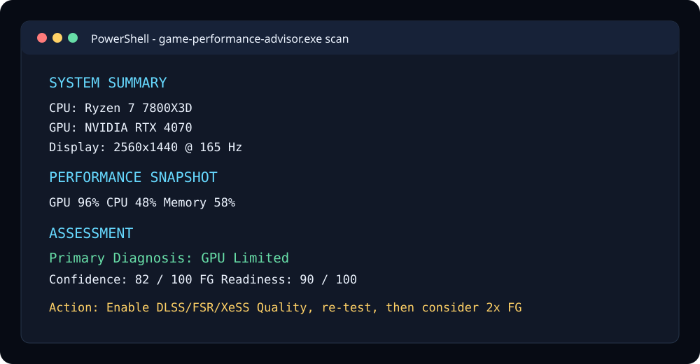

# Game Performance Advisor

Game Performance Advisor is a Windows-first systems diagnostics utility for gamers,
benchmarkers, and esports operators. It inspects hardware and live resource pressure,
identifies likely GPU/CPU/mixed bottlenecks, and produces actionable recommendations
for upscaling and frame generation.

The tool is diagnostic only. It does not hook games, inject code, overlay the desktop,
modify frames, or communicate with a graphics API.

## Screenshots

The portfolio screenshot is an SVG terminal demonstration:



Generate a live HTML capture report to get the portfolio-ready frame chart and
recommendation cards:

```powershell
game-performance-advisor.exe capture 15s --html benchmark-capture.html
```

## Benchmark example

Example of a real before/after capture comparison:

| Metric | Before | After Quality Upscaling | Change |
|---|---:|---:|---:|
| Average FPS | 57.2 | 71.8 | +14.6 |
| 1% Low FPS | 42.4 | 56.1 | +13.7 |
| 0.1% Low FPS | 28.1 | 38.7 | +10.6 |
| Stutters | 11.2% | 6.4% | -4.8 pp |

The illustrative values show the report shape. They are not a claim about any
specific GPU or game. Real recommendations should use actual PresentMon captures.

## Primary workflow

```powershell
game-performance-advisor.exe scan
```

Example:

```text
┌────────────────────────────────────────────┐
│ GAME PERFORMANCE ADVISOR                   │
└────────────────────────────────────────────┘

System Summary
  Detected CPU       AMD Ryzen 7 7800X3D
  Detected GPU       NVIDIA RTX 4070
  Memory             32.0 GB
  Display            2560x1440 @ 165 Hz

Performance Snapshot
  GPU utilization    96%
  CPU utilization    48%
  Memory utilization 58%

Performance Assessment
  Performance Score          78 / 100
  FG Readiness               90 / 100
  Confidence                 82 / 100
  Primary Diagnosis          GPU Limited
```


## Monitoring

The desktop monitoring commands are resource snapshots and should not be used as
frame-generation evidence:

```powershell
game-performance-advisor.exe monitor --duration 15 --interval 2
```

Convenience syntax for a 15-second capture:

```powershell
game-performance-advisor.exe capture 15s
```

Capture/monitor support live utilization and running process information. Real frame
timing, PresentMon, ETW, RTSS, or FrameView integration can be added later without
changing the system-analysis report model.

## Real frame capture with PresentMon

The interactive workflow is:

1. Run `game-performance-advisor.exe capture`.
2. The tool waits for gameplay processes.
3. Launch Steam, Epic, Riot, Battle.net, HoYoPlay, or the game directly.
4. Review the confidence-ranked candidates.
5. Confirm or manually select the game executable.
6. Capture starts and the report is generated after capture ends.

PresentMon is authoritative for frame timing. Desktop CPU/GPU/memory values are
never used by themselves to select a game.

Install Intel PresentMon and add `PresentMon.exe` to `PATH`, or pass its location with
`--presentmon`.

Capture for a fixed duration:

```powershell
game-performance-advisor.exe capture 15s --target-fps 144 --html capture.html --report capture.md
```

Start a manual play session and press ENTER to stop:

```powershell
game-performance-advisor.exe capture --manual --target-fps 144 --html capture.html
```

Capture a named process or process ID:

```powershell
game-performance-advisor.exe capture --duration 15 --process "Cyberpunk2077.exe" --target-fps 60
game-performance-advisor.exe capture --duration 15 --pid 1234 --presentmon "C:\Tools\PresentMon.exe"
```

The capture produces:

- A raw PresentMon CSV
- A normalized `*-frametimes.csv`
- Average and 1%/0.1% low FPS
- Stutter percentage
- Frame health scores
- Bottleneck diagnosis and evidence
- DLSS/FSR/XeSS and frame-generation suitability

The raw capture is converted into the existing frametime analysis engine before
recommendations are generated.

## Before / after comparison

Save normalized captures and compare them after a settings or driver change:

```powershell
game-performance-advisor.exe capture 30s --save before.csv --target-fps 60
game-performance-advisor.exe capture 30s --save after.csv --target-fps 60
game-performance-advisor.exe compare before.csv after.csv --report comparison.md --html comparison.html
```

The report shows changes in average FPS, 1% lows, 0.1% lows, frame health, stutters,
and the resulting recommendation.

## Reports

Generate Markdown or HTML:

```powershell
game-performance-advisor.exe scan --report scan.md --html scan.html
```

Emit JSON:

```powershell
game-performance-advisor.exe scan --json
```

## Advanced frame-time import

CSV and JSON remain available for situations where frame-time measurements were
captured separately:

```powershell
game-performance-advisor.exe analyze samples\smooth_60fps.csv --target-fps 60 --report frame-analysis.md
```

Supported CSV header:

```csv
frame,frametime_ms
1,16.67
2,16.71
```

## Build

Requirements:

- Windows 10/11 for native machine collection
- Go 1.26 or newer

```powershell
go mod tidy
go test ./...
go build -o game-performance-advisor.exe ./cmd/game-performance-advisor
.\game-performance-advisor.exe scan
```

PowerShell is used to query Windows CIM/WMI inventory and performance counters.
NVIDIA utilization is enhanced with `nvidia-smi` when available. Missing metrics are
reported explicitly rather than fabricated.

## Docker

The binary is built in a multi-stage Docker image:

```powershell
docker build -t game-performance-advisor .
docker run --rm game-performance-advisor analyze /samples/smooth_60fps.csv --target-fps 60
```

Container environments cannot inspect the Windows host by default. Native Windows
`scan` and `monitor` should be run on the target PC. Docker is most useful for the
advanced CSV workflow or CI builds.

## Architecture

```text
cmd/game-performance-advisor/
internal/
  system/       Windows/CIM machine inventory
  metrics/      live utilization and process discovery
  analysis/     bottleneck, confidence, and score calculations
  recommend/    explainable action and FG readiness rules
  report/       terminal, Markdown, JSON, and HTML rendering
  input/        advanced CSV/JSON frame imports
```

## Diagnostics

- GPU-limited: GPU utilization is high while CPU utilization is not dominant.
- CPU-limited/mixed: CPU utilization is high or utilization patterns suggest mixed pressure.
- Memory pressure: memory utilization is at or above a high-pressure threshold.
- Balanced: no dominant pressure is detected.

Confidence and recommendations are deliberately transparent. Missing GPU telemetry,
display refresh, or game-process detection lowers confidence and is stated in the
Evidence/Limitations section.

## Tests

```powershell
go test ./...
```

The tests cover bottleneck classification, unavailable telemetry, GPU/CPU
recommendations, frame imports, and report generation.

## AI-assisted development notes

**PLACEHOLDER: Add the AI tools used, approximate time spent, key implementation
steps, and validation performed.**
