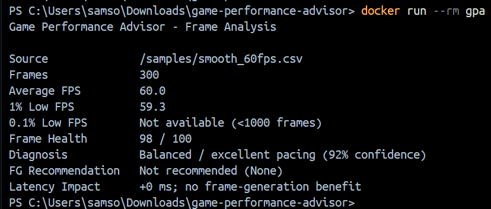
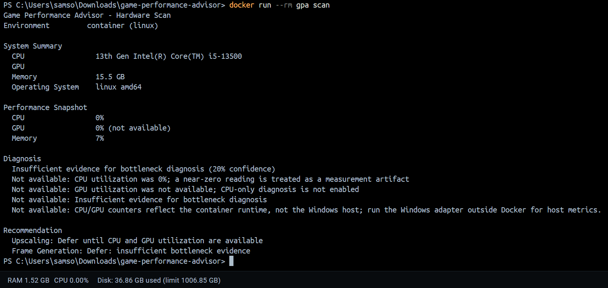
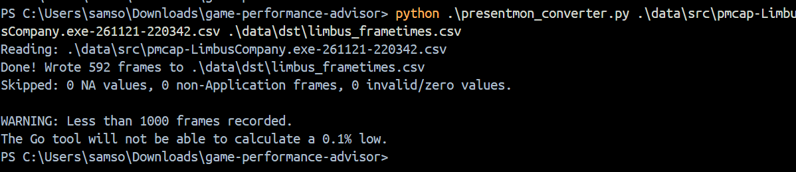
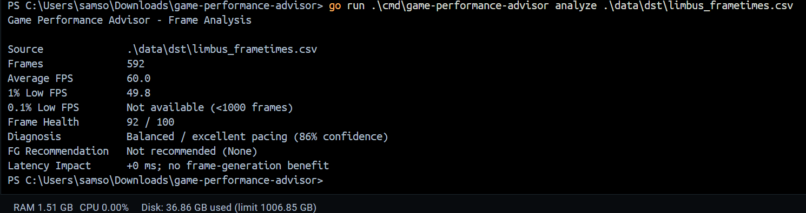
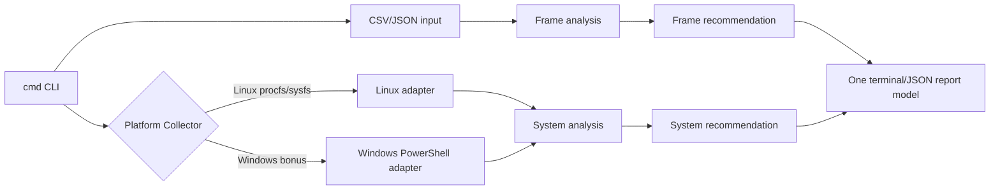

# Game Performance Advisor

Game Performance Advisor is a cross-platform Go CLI for frame-time analysis. Linux and Docker are the primary supported workflow; Windows hardware inventory is a bonus adapter.

GPA reads a simple CSV or JSON frame-time recording and reports average FPS, low FPS, stutter share, coefficient of variation, frame health, and a rule-based recommendation.

## Quick Start: Linux and Docker

Build and run the default Docker result:

```bash
docker build -t gpa .
docker run --rm gpa
```



The default command analyzes `samples/smooth_60fps.csv`.

Analyze another bundled sample:

```bash
docker run --rm gpa analyze /samples/mixed_hitching.csv --target-fps 60
```

Mount the repository directory and analyze one of its real bundled CSV files. In Bash:

```bash
docker run --rm --mount type=bind,source="$(pwd)",target=/data gpa analyze /data/samples/mixed_hitching.csv --target-fps 60
```

In PowerShell:

```powershell
docker run --rm --mount "type=bind,source=$((Get-Location).Path),target=/data" gpa analyze /data/samples/mixed_hitching.csv --target-fps 60
```

On Linux, scan hardware explicitly:

```bash
docker run --rm gpa scan
go run ./cmd/game-performance-advisor scan
```



`scan` reports procfs/sysfs inventory and, where available, NVIDIA utilization. Missing GPU or display values are shown as unavailable rather than fabricated.
The native `scan` adapter is currently supported on Linux and Windows. macOS is not currently a supported build target.

In Docker, JSON `scan` output includes `"environment": "container (linux)"`. Its CPU/GPU counters reflect the container runtime, not the Windows host. Run the Windows adapter natively for host metrics.

The `scan` evidence gate does not emit a balanced bottleneck diagnosis from a 1% CPU reading or unavailable GPU data. It instead returns:

```text
Diagnosis
  Insufficient evidence for bottleneck diagnosis (20% confidence)

Recommendation
  Frame Generation: Defer: insufficient bottleneck evidence
```

## CLI

```text
game-performance-advisor analyze <frame-times.csv|json> [--target-fps 60] [--stutter-threshold 1.8] [--input-format auto|csv|json] [--json]
game-performance-advisor scan [--json]
```

`analyze` is the primary product and works on Linux and Windows.

## CSV Format

```csv
frame,frametime_ms
1,16.67
2,16.71
```

The `frametime_ms` column is required. Missing, blank, invalid, zero, and negative values are errors. Extra columns are allowed. Raw multi-column exports from CapFrameX or RTSS require conversion.

## Example data and Python helper

The `data/` directory contains example recordings and converted CSV files:

- `data/src/` contains raw capture examples.
- `data/dst/` contains compatible files with the required `frame,frametime_ms` columns.

The optional `presentmon_converter.py` helper converts a raw Intel PresentMon capture export into
the CSV format accepted by GPA. It is not part of the Go CLI or its runtime:

```powershell
python .\presentmon_converter.py .\data\src\pmcap-LimbusCompany.exe-261121-220342.csv .\data\dst\limbus_frametimes.csv

docker run --rm --mount "type=bind,source=$((Get-Location).Path),target=/data" gpa analyze /data/data/dst/limbus_frametimes.csv
```



The helper filters invalid rows and reports how many frames were written. You
can also analyze a converted file directly with a local Go build:

```powershell
go run .\cmd\game-performance-advisor analyze .\data\dst\limbus_frametimes.csv
```



## Analysis Rules

The implementation deliberately does not percentile instantaneous FPS.

- 1% low and 0.1% low sort frametimes, select the slowest `ceil(frame_count × 0.01)` or `ceil(frame_count × 0.001)` frames, average those frametimes, and convert `1000 / average_ms` to FPS.
- 1% lows require at least 100 frames.
- 0.1% lows require at least 1000 frames.
- A frame is a stutter when it exceeds `1.8 × median frametime`. This is a candidate heuristic, not a hardware benchmark.
- Widely split or bimodal distributions produce an ambiguity limitation rather than a clean diagnosis.
- Coefficient of variation is standard deviation divided by mean frametime.

For 1000 frames containing 999 frames at 16.67 ms and one 100 ms frame:

- 1% low uses the slowest 10 frames: `(9 × 16.67 + 100) / 10 = 25.003 ms`, or approximately `39.995 FPS`.
- 0.1% low uses the single slowest frame: `1000 / 100 = 10 FPS`.

Known-value tests cover constant, ramp, bimodal, every-tenth-frame, and single-hitch distributions.

## Bottleneck and Recommendation Heuristics

The system scan uses documented candidate thresholds:

- GPU-limited: GPU ≥95% and CPU <85%.
- CPU-limited: CPU ≥92%.
- Mixed/ambiguous: GPU ≥80% and CPU 55-84%.

These thresholds are tunable heuristics. The frame recommendation is tied to stable pacing, target FPS, and bottleneck evidence: CPU-heavy or unstable streams are not recommended for frame generation.

Hardware bottleneck diagnosis requires a CPU measurement over at least 1 second with a plausible value above 5%, plus GPU utilization availability. If evidence is insufficient, the diagnosis is `"Insufficient evidence for bottleneck diagnosis"` with confidence capped at 20, and frame generation is deferred rather than recommended.

## Architecture



## Scope Trade-Off

The submission intentionally keeps only `scan` and `analyze` because they are the two commands that provide a runnable Linux/Docker result and a defensible scope without extra report paths.

## AI-Assisted Workflow

Tools: GitHub Copilot and direct repository inspection.

The project was developed in short, scoped passes:

1. Scope freeze: keep frame-time CSV analysis and remove unsupported capture claims.
2. Cross-platform pass: stop blocking Linux and route frame analysis through Docker.
3. Code review: replace an AI-suggested `fmt.Errorf(dynamicString)` issue with a constant error and rerun tests.
4. Math review: identify that percentile logic must operate on frame times, not instantaneous FPS. I added known-value and bimodal tests rather than trusting passing calculations.
5. Scope cut: reduce the product to the two runnable command paths.

Approach to AI output:

- Every README/platform claim was checked against source.
- Generated code was accepted only after tests and Docker runs.
- The AI's broad "Windows plus four commands" implementation was deliberately cut to the two-command submission.
- Approximate time spent: about two days.

## Windows Bonus

Windows hardware collection remains available through `scan`. The Windows PowerShell scripts are embedded in the executable and run through encoded PowerShell commands; this adapter is separate from the Linux adapter. The Windows executable is cross-built in CI and attached to tagged GitHub Releases.

## Development

```bash
go test ./...
go build ./cmd/game-performance-advisor
docker build -t gpa .
docker run --rm gpa
```

## Limitations

- The stutter threshold and bottleneck thresholds are candidate heuristics.
- Small captures do not report low FPS metrics when the frame count is insufficient.
- Windows hardware metrics depend on the available WMI/PowerShell environment.
- Linux GPU utilization depends on `nvidia-smi` and may remain unavailable. ROCm can help identify an AMD GPU, but is not currently used to collect Linux GPU utilization.
